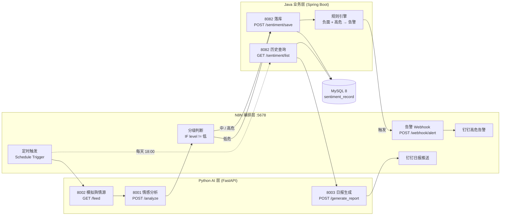

# 企业级舆情监控与自动告警 Agent

基于 **N8N + Python + Java** 的三栈微服务项目，实现从舆情采集、大模型情感分析、数据持久化到钉钉实时告警与日报生成的完整闭环。

[](https://www.python.org/)
[](https://fastapi.tiangolo.com/)
[](https://openjdk.org/)
[](https://spring.io/projects/spring-boot)
[](https://n8n.io/)
[](https://www.mysql.com/)

---

## 一、项目简介

本项目的目标是把「**舆情监控**」做成一条无人值守的流水线：

1. **N8N** 按计划拉取舆情数据，统一编排服务调用与条件分流；
2. **Python** 调用阿里云百炼 **Qwen-Max**，把非结构化新闻转成 `sentiment` / `level` / `reason` 结构化结果；
3. **Java** 负责业务落库，并内置规则引擎——当数据同时满足「负面 + 高危」时，主动回调 N8N Webhook 触发钉钉群告警；
4. **N8N** 每天定时汇总历史数据，交给 Python 生成 Markdown 日报并推送到钉钉群。

项目刻意把 **编排（N8N）、AI 能力（Python）、业务规则与持久化（Java）** 拆成三层，避免把业务逻辑堆在可视化工作流里，三层都可以独立开发、独立测试、独立部署。

---

## 二、核心特性

- **三栈分层架构**：N8N 负责编排、Python 负责 AI、Java 负责业务与规则，职责边界清晰。
- **LLM 输出结构化**：强制 `response_format={"type": "json_object"}`，并内置 ` ```json ` 代码围栏清理与「首个 `{` 到末个 `}`」兜底解析，模型偶尔"多说一句话"也不会让流程崩溃。
- **失败降级而不是崩溃**：未配置 `ALI_API_KEY` 时服务仍可启动，仅在真正调用模型时返回 `503`；日报生成失败会以文本形式返回，不会中断工作流。
- **规则引擎前置判断**：Java 侧判断「负面 + 高危」后主动触发 Webhook，告警链路不依赖人工操作。
- **自动化测试覆盖**：Python 9 个用例（`pytest`）+ Java 2 个用例（JUnit 5 + Mockito），均在无外部依赖（不连模型、不连数据库）的方式下运行。
- **开箱即用的工作流存档**：两份 N8N 工作流已导出为 JSON，导入即可复用；敏感信息（钉钉 `access_token`、`ALI_API_KEY`、数据库密码）全部占位化，不提交真实凭据。

---

## 三、系统架构



### 数据流说明

| 阶段 | 触发方式 | 参与方 | 结果 |
| --- | --- | --- | --- |
| 舆情采集 | N8N 定时触发 | N8N → Python `:8002` | 返回 2~4 条待分析舆情 |
| 情感分析 | 数据到达后自动执行 | N8N → Python `:8001` | 追加 `sentiment` / `level` / `reason` |
| 条件分流 | N8N IF 节点 | N8N 内部 | 中/高危与低危分别走不同分支 |
| 持久化 | 两个分支都会执行 | N8N → Java `:8082` | 写入 `sentiment_record` 表 |
| 实时告警 | Java 规则引擎判断 | Java → N8N `/webhook/alert` | 负面 + 高危时推送钉钉群 |
| 日报生成 | 每天 18:00 | N8N → Java 查询 → Python `:8003` → 钉钉 | 生成 Markdown 日报并推送 |

---

## 四、技术栈与职责分工

| 层级 | 技术 | 职责 |
| --- | --- | --- |
| 编排层 | N8N | 定时调度、HTTP 调用、IF 条件分流、Webhook 接收、钉钉消息推送 |
| AI 层 | Python 3.12 + FastAPI + OpenAI SDK（兼容 DashScope） | 情感分析、模拟数据源、日报生成 |
| 业务层 | Java 21 + Spring Boot 3.4.5 + MyBatis-Plus 3.5.9 | 数据校验、持久化、告警规则引擎 |
| 存储 | MySQL 8（utf8mb4） | 舆情记录持久化 |
| 部署 | Docker Compose（N8N） | 本地一键启动 N8N 及其持久化数据卷 |

**LLM**：阿里云百炼 `qwen-max`，通过 DashScope 的 OpenAI 兼容模式（`https://dashscope.aliyuncs.com/compatible-mode/v1`）调用。

---

## 五、目录结构

```text
dingding-consturct/
├── .editorconfig                        # 统一编码与缩进
├── .gitignore                           # 忽略构建产物、运行时数据与敏感文件
├── README.md
├── scripts/
│   └── validate_n8n_workflows.py        # N8N 工作流 JSON 静态校验脚本
└── sentiment-project/
    ├── .env.example                     # 环境变量模板（复制为 .env 后填写）
    ├── docker-compose.yml               # 仅启动 N8N（5678）
    ├── python-svc/                      # Python AI 层
    │   ├── app.py                       # 8001 情感分析
    │   ├── news_feed_service.py         # 8002 模拟舆情数据源
    │   ├── report_gen.py                # 8003 日报生成
    │   ├── requirements.txt             # 运行依赖
    │   ├── requirements-dev.txt         # 测试依赖
    │   ├── Dockerfile                   # 可容器化部署（默认 8001）
    │   ├── tests/
    │   │   ├── conftest.py
    │   │   └── test_services.py         # 9 个 pytest 用例
    │   └── __init__.py
    ├── java-svc/                        # Java 业务层
    │   ├── pom.xml
    │   └── src/
    │       ├── main/java/com/saas/kb/agent/
    │       │   ├── AgentApplication.java
    │       │   ├── controller/SentimentController.java
    │       │   ├── entity/SentimentRecord.java
    │       │   ├── mapper/SentimentRecordMapper.java
    │       │   └── notifier/AlertNotifier.java
    │       ├── main/resources/
    │       │   ├── application.yml      # 端口 / 数据源（支持环境变量覆盖）
    │       │   └── db/schema.sql        # sentiment_record 建表脚本
    │       └── test/java/com/saas/kb/agent/controller/
    │           └── SentimentControllerTest.java  # 2 个 Mockito 用例
    └── n8n-workflows/
        ├── workflow_A_dingtalk.json     # A · 钉钉高危告警推送
        └── workflow_B_analysis.json     # B · 舆情采集与情感分析
```

---

## 六、快速开始

### 6.1 前置条件

| 依赖 | 版本要求 | 说明 |
| --- | --- | --- |
| JDK | 21+ | 运行 Spring Boot |
| Maven | 3.9+ | 构建 Java 模块 |
| Python | 3.12+ | 运行 AI 服务 |
| MySQL | 8.0+ | 存储舆情记录，库名建议 `project06` |
| Docker（含 Compose） | 24+ | 启动 N8N |
| 阿里云百炼 API Key | — | 在[百炼控制台](https://bailian.console.aliyun.com/)创建 |

### 6.2 配置环境变量

```bash
cd sentiment-project
cp .env.example .env
# 编辑 .env，至少填入 ALI_API_KEY
```

`.env` 字段说明：

| 变量 | 用途 | 默认值 |
| --- | --- | --- |
| `ALI_API_KEY` | DashScope API Key（Python 服务读取） | 无，必填 |
| `DB_URL` | Java 数据源 JDBC URL | `jdbc:mysql://localhost:3306/project06?...` |
| `DB_USERNAME` | 数据库用户名 | `root` |
| `DB_PASSWORD` | 数据库密码 | `123456`（仅本地默认值） |

> 钉钉机器人 `access_token` 不放在 `.env` 中：导入 N8N 工作流后，在「A · 钉钉高危告警推送」的 HTTP Request 节点内替换 `YOUR_DINGTALK_ACCESS_TOKEN`。

### 6.3 启动 Python 服务

```bash
cd sentiment-project/python-svc
python -m venv .venv
# Windows
.venv\Scripts\activate
# macOS / Linux
# source .venv/bin/activate

pip install -r requirements.txt

# 三个服务分别启动（或使用下方 Docker 方式）
python app.py               # 8001 情感分析
python news_feed_service.py # 8002 模拟舆情源
python report_gen.py        # 8003 日报生成
```

> `requirements.txt` 中锁定 `httpx==0.27.2`：`openai==1.51.0` 会向 `httpx.Client` 传 `proxies` 参数，而 httpx 0.28 已移除该参数，不锁定会导致**导入阶段**直接 `TypeError`。

Docker 方式（以情感分析服务为例）：

```bash
docker build -t sentiment-python-svc .
docker run --rm -p 8001:8001 --env-file ../.env sentiment-python-svc
# 覆盖启动其它服务：
# docker run --rm -p 8002:8002 sentiment-python-svc python news_feed_service.py
# docker run --rm -p 8003:8003 --env-file ../.env sentiment-python-svc python report_gen.py
```

### 6.4 初始化数据库并启动 Java 服务

```bash
mysql -u root -p -e "CREATE DATABASE IF NOT EXISTS project06 DEFAULT CHARACTER SET utf8mb4;"
mysql -u root -p project06 < sentiment-project/java-svc/src/main/resources/db/schema.sql

cd sentiment-project/java-svc
mvn clean package -DskipTests
java -jar target/*.jar
# 或直接：mvn spring-boot:run
```

服务默认监听 `8082`，数据源参数可用环境变量 `DB_URL` / `DB_USERNAME` / `DB_PASSWORD` 覆盖（见 `application.yml`）。

### 6.5 启动 N8N 并导入工作流

```bash
cd sentiment-project
docker compose up -d
# 打开 http://localhost:5678 完成 N8N 初始化（首次需创建账号）
```

导入步骤：

1. 右上角 **… → Import from File**，选择 `n8n-workflows/workflow_A_dingtalk.json`，导入后 **保存**；
2. 打开「钉钉群机器人」节点，把 URL 中的 `YOUR_DINGTALK_ACCESS_TOKEN` 换成真实机器人 token；
3. 同样导入 `workflow_B_analysis.json`；
4. 两个工作流默认 `active=false`，确认节点配置无误后手动启用。

> N8N 运行在容器里，工作流通过 `host.docker.internal` 访问宿主机上的 Python（8001/8002）与 Java（8082）服务，`docker-compose.yml` 已配置 `extra_hosts` 兼容 Linux。

---

## 七、API 说明

### 7.1 Python 服务

#### `POST http://localhost:8001/analyze` — 情感分析

请求：

```json
{
  "title": "产品被大量投诉",
  "content": "这款产品最近差评如潮，客服电话被打爆，用户要求退款。",
  "source": "weibo"
}
```

响应：

```json
{
  "title": "产品被大量投诉",
  "content": "这款产品最近差评如潮，客服电话被打爆，用户要求退款。",
  "source": "weibo",
  "sentiment": "负面",
  "level": "高",
  "reason": "差评集中且出现集中退款诉求，存在扩散风险"
}
```

| 字段 | 说明 |
| --- | --- |
| `sentiment` | `正面` / `中性` / `负面` |
| `level` | `高` / `中` / `低`；仅负面舆情可能被评为中/高 |
| `source` | 原样回传，N8N 工作流依赖该字段 |

大模型调用失败时返回 `503`，`detail` 形如 `大模型调用失败: ...`。

#### `GET http://localhost:8002/feed` — 模拟舆情数据源

返回 2~4 条随机舆情（字段：`title`、`content`、`source`），用于本地联调，不依赖任何外部新闻源。

#### `POST http://localhost:8003/generate_report` — 生成日报

请求：

```json
{ "records": [{ "title": "服务器宕机", "sentiment": "负面", "level": "高" }] }
```

响应：

```json
{ "report": "# 今日舆情简报\n..." }
```

空记录直接返回 `{"report": "今日暂无舆情记录。"}`；模型异常时返回 `{"report": "报告生成失败：..."}`，工作流不会中断。

### 7.2 Java 服务

#### `POST http://localhost:8082/sentiment/save` — 落库

请求体（`SentimentRecord`）：

```json
{
  "tenantId": 1,
  "title": "产品被大量投诉",
  "content": "这款产品最近差评如潮……",
  "sentiment": "负面",
  "level": "高",
  "source": "weibo"
}
```

成功响应：

```json
{ "code": 200, "msg": "落库成功", "id": 1834567890123456789 }
```

规则引擎：当 `sentiment == "负面"` 且 `level == "高"` 时，会向 N8N 发送 `POST http://localhost:5678/webhook/alert`（body：`title`、`content`），由工作流 A 推送钉钉告警。

#### `GET http://localhost:8082/sentiment/list` — 查询全部记录

返回 `List<SentimentRecord>`，供日报生成时汇总历史数据。

---

## 八、N8N 工作流说明

| 工作流 | 文件 | 触发方式 | 关键节点 |
| --- | --- | --- | --- |
| A · 钉钉高危告警推送 | `workflow_A_dingtalk.json` | Webhook `POST /webhook/alert` | `告警 Webhook` → `钉钉群机器人` |
| B · 舆情采集与情感分析 | `workflow_B_analysis.json` | Schedule Trigger（15:00） | `定时触发` → `拉取模拟舆情` → `情感分析` → `分级判断`（IF `level != 低`）→ `落库(中/高危)` / `落库(低危)` |

- 工作流 A 的钉钉节点使用 `oapi.dingtalk.com/robot/send`，消息模板包含【舆情高危告警】标题与正文；
- 工作流 B 两个分支最终都调用 Java `:8082/sentiment/save`，**告警实际由 Java 规则引擎触发**，IF 节点目前只承担分流与可扩展占位；
- 工作流 B 的定时为 `15:00`，日报推送链路（18:00）可按部署需要另行配置；
- 两份 JSON 均已脱敏：`access_token` 替换为 `YOUR_DINGTALK_ACCESS_TOKEN`，删除 `instanceId`，`active` 置为 `false`。

---

## 九、测试

### Python（9 个用例）

```bash
cd sentiment-project/python-svc
pip install -r requirements-dev.txt
python -m pytest -q
# 9 passed
```

覆盖范围：

- `/analyze`：正常结构化返回、` ```json ` 围栏解析、畸形 JSON 默认值兜底、LLM 异常 → 503；
- `/feed`：2~4 条且字段齐全非空；
- `/generate_report`：正常生成、空记录不调用模型、模型异常写入 body；
- 导入安全：无 `ALI_API_KEY` 时 `app.py` / `report_gen.py` 仍可 import。

### Java（2 个用例）

```bash
cd sentiment-project/java-svc
mvn -o test        # 首次构建如缺依赖请去掉 -o
# Tests run: 2, Failures: 0, Errors: 0 — BUILD SUCCESS
```

纯 Mockito 单测：`@Mock SentimentRecordMapper` + `@Mock AlertNotifier`，不启动 Spring 容器、不连接 MySQL，分别验证「负面 + 高」触发告警与「正面 + 低」不触发告警。

### N8N

```bash
python scripts/validate_n8n_workflows.py
# OK  workflow_A_dingtalk.json (2 nodes)
# OK  workflow_B_analysis.json (6 nodes)
# All 2 workflows passed validation
```

校验 JSON 合法性、必填字段、节点名/ID 唯一性、连接目标存在性、触发器存在性，以及是否残留真实钉钉 token。

---

## 十、安全与配置说明

- 仓库不包含任何真实凭据：`.env` 已被 `.gitignore` 忽略，示例值统一为占位符；
- 数据库密码支持环境变量覆盖，生产环境请通过部署平台注入，不要使用默认值；
- N8N 的运行时数据（`n8n_data/`，含 SQLite 数据库）不纳入版本控制，工作流以 JSON 形式存档；
- 若仓库需要公开演示，建议同时轮换历史 token 并清理 Git 历史，而不是只改当前文件。

---

## 十一、后续可扩展方向

- 接入真实新闻源（RSS / 微博 / 第三方舆情 API）替换模拟数据源；
- 用向量检索 + RAG 对舆情做归因分析与相似事件聚类；
- 将 Java 规则引擎外置为可配置规则表，支持按租户定制告警策略；
- 为 N8N 工作流增加失败重试、死信队列与告警降噪（去重 / 抑制窗口）；
- 增加 Docker Compose 一键拉起 Python + Java + MySQL + N8N 的完整本地环境。

---

## License

本项目仅用于学习与工程实践演示。
